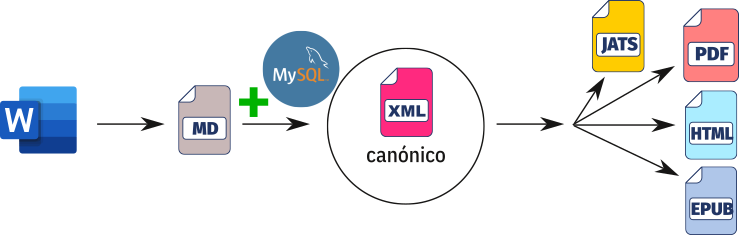

[Español](README.md) | **English**

> [!IMPORTANT]
> If you are considering installing gbpublisher on your computer, first read **[LEER-INSTALADOR.md](LEER-INSTALADOR.md)** (in Spanish).

**gbpublisher** is an editorial production system for academic books and scholarly journals. It takes the work from the manuscript to the final outputs —PDF, EPUB, HTML and the XML files required by indexing services— from a single canonical XML source: DocBook 5 for books and JATS 1.4 for journals.

It is a desktop application for Linux with a client-server architecture. The editorial team works on a shared MySQL database, even when each person works from home. It is meant for the people who produce the book or the journal (editing, proofreading, layout and coordination); it is not designed for authors.

Texts are written in Markdown and normalized with Pandoc. Outputs are derived from the canonical XML through XSLT and typeset with LuaLaTeX. The PDF is the reference; the EPUB and HTML faithfully reproduce its structure. The critical tools in the process (Pandoc, Saxon-HE, epubcheck, veraPDF, packtools) are installed in fixed versions, so a title can be regenerated identically years later.

Each publisher installs its own copy, owns its data and manages its own credentials: there is no central server and no intermediaries. Only open standards are used.

---

## Installation

**gbpublisher is installed with its installer, `instalador.sh`.** It is the only file you need to download: the installer downloads and installs everything else, including the application itself.

Before running it, read **[LEER-INSTALADOR.md](LEER-INSTALADOR.md)** (in Spanish): it explains what you need, how to run it, what it does on your computer and what to do if something fails. The installer asks whether you have read it before it starts.

Each version publishes its own installer on the [releases](https://github.com/albertomoyano/gbpublisher/releases) page, with the line to paste into a terminal.

---

## Production model

gbpublisher implements a **Single Source Publishing** workflow: content is written in Markdown, transformed into canonical XML and enriched with metadata from a MySQL database. The result is a **validated canonical XML** (JATS for journals and DocBook for books) that serves as the single source for every editorial output.

From that canonical XML it generates:

- **Journals:** PDF, EPUB 3 and HTML; the XML files for Crossref, DOAJ, SciELO and Redalyc/Marcalyc.
- **Books:** PDF typeset with LuaLaTeX (also PDF/A), EPUB 3 and HTML.

PubMed Central is on the roadmap; it is not implemented yet.

This approach ensures reproducibility, traceability and full portability of the content, without depending on proprietary platforms or external services.

---

## Development status

- **Journals:** operational, from manuscript intake to the outputs for indexing services, the web and print.
- **Books:** under active development. It already produces complete titles with indexes, glossary, acronyms, notes and bibliography in APA, ISO 690, IEEE and Vancouver.

---

## Main features

**Metadata management**
- Authors, affiliations, ORCID, ROR
- Bibliographic references (BibTeX/BibLaTeX)
- Keywords, institutional data, information for indexing services
- Editorial workflow control: status of each piece and publication

**Editing and production**
- Built-in editor with syntax highlighting for Markdown and XML
- Generation and validation of the canonical XML with Saxon-HE
- Transformation into multiple outputs through XSLT 2.0

**Validation and quality**
- The canonical XML is validated against its schema (RNG or DTD) and against Schematron rules, both the project's own and JATS4R's
- Each output goes through its validator: epubcheck, veraPDF, the Nu Html Checker (vnu) and packtools for SciELO
- DOI verification against Crossref; ORCID lookup
- The files for DOAJ and Crossref are generated and validated in the application, and uploaded by hand to each service

**External XML auditor**
- Reviews a JATS file produced outside gbpublisher: structure, DTD and a subset of the JATS4R rules

---

## System requirements

- **Linux Mint with the Cinnamon desktop** (the only supported platform)
- **X11 display server**
- Gambas 3.22 with Qt 6 (installed by the `.deb` package)
- MySQL 8
- Java
- Full TeX Live
- xmllint

The tools that determine the result of an output are not taken from the system: they are installed in fixed versions under `/opt` from the application itself (menu **Acerca de → Controlar integridad del sistema**, with a project open). They are Pandoc 3.1.3, Saxon-HE 12.9, epubcheck 4.2.6, veraPDF 1.30.1, packtools 4.18.2 and the HTML validator vnu 26.7.3. Without vnu, the HTML output is not generated.

The application interface is in Spanish.

---

## License

gbpublisher is distributed under the **Business Source License 1.1 (BSL 1.1)**.

**Permitted use at no cost:** editorial production of scholarly or academic journals that do not charge APCs (Article Processing Charges) to authors, under any name.

**Use that requires a commercial license:** journals that charge APCs, editorial services for third parties, SaaS platforms and redistribution of the software.

Each released version automatically converts its license to **GPL-3.0-or-later** five years after its release date.

See [LICENSE.md](LICENSE.md) for the full terms (in Spanish). This summary is for information only: the Spanish text is the one that applies.

---

## Project information

- Repository: [https://github.com/albertomoyano/gbpublisher](https://github.com/albertomoyano/gbpublisher)
- Installation: [LEER-INSTALADOR.md](LEER-INSTALADOR.md) (in Spanish)
- Database: [BBDD_LEEME.md](BBDD_LEEME.md) (in Spanish)
- Architecture: [ARCHITECTURE.md](ARCHITECTURE.md) (in Spanish)
- Licensing inquiries: [contacto@estudio2a.ar](mailto:contacto@estudio2a.ar)
- How to support the project: [SUPPORT_MODEL.md](SUPPORT_MODEL.md) (in Spanish)

**Copyright © 2026 Alberto Moyano**
