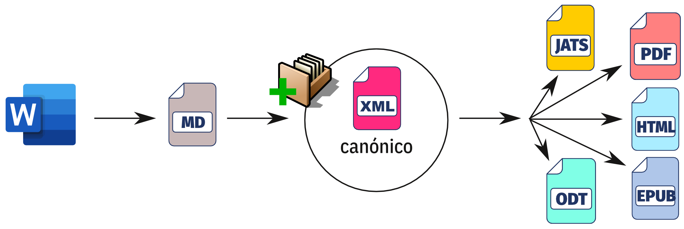

**gbpublisher** es un sistema de producción editorial para libros académicos y revistas científicas. Lleva el trabajo desde el manuscrito hasta las salidas finales —PDF, EPUB, HTML y los XML que piden los indexadores— a partir de una única fuente XML canónica: DocBook 5 para libros y JATS 1.4 para revistas.

Es una aplicación de escritorio para Linux con arquitectura cliente-servidor. El equipo editorial trabaja sobre una base MySQL compartida, aunque cada persona esté en su casa. La usan quienes producen el libro o la revista (edición, corrección, composición), no quienes lo escriben.

Los textos se escriben en Markdown y se normalizan con Pandoc. Las salidas salen del XML canónico por XSLT y se componen con LuaLaTeX. El PDF es la referencia, el EPUB y el HTML reproducen fielmente su estructura. Las versiones del stack están fijas y se verifican al arrancar, así que un título puede regenerarse idéntico años después.

Cada editorial instala su propia copia, es dueña de sus datos y maneja sus propias credenciales: no hay servidor central ni intermediarios. Solo se usan estándares abiertos.

---

## Modelo de producción

gbpublisher implementa un flujo **Single Source Publishing**: el contenido se redacta en Markdown, se transforma a un XML canónico y se enriquece con metadatos desde una base de datos MySQL. El resultado es un **XML canónico validado** (JATS para revistas y DocBook para libros) que actúa como fuente única para todas las salidas editoriales.

Desde ese XML canónico se generan:

- ODT, EPUB 3, HTML y PDF
- XML para indexadores: DOAJ, Crossref, SciELO, PubMed, Redalyc

Este enfoque garantiza reproducibilidad, trazabilidad y portabilidad total de los contenidos, sin depender de plataformas propietarias ni servicios externos.

---

## Funcionalidades principales

**Gestión de metadatos**
- Autores, afiliaciones, ORCID, ROR
- Referencias bibliográficas (BibTeX/BibLaTeX)
- Palabras clave, datos institucionales, información para indexadores
- Órdenes de taller y control del flujo editorial

**Edición y producción**
- Editor integrado con resaltado de sintaxis para Markdown y XML
- Generación y validación del XML canónico con Saxon-HE
- Transformación a múltiples salidas mediante XSLT 2.0

**Validación y calidad**
- Validación de JATS por flavor (CrossRef, SciELO, PubMed, JATS4R, Redalyc)
- Verificación de DOI contra CrossRef
- Integración con ORCID y DOAJ

---

## Requisitos del sistema

- **Linux Mint con escritorio Cinnamon** (única plataforma soportada)
- **Servidor de pantalla X11**
- Gambas 3.21 o superior
- Pandoc
- MySQL
- xmllint
- docbook
- Saxon-HE (JAR principal + carpeta `lib/`)
- Java
- TeXLive full
- veraPDF
- vnu

---

## Licencia

gbpublisher se distribuye bajo la **Business Source License 1.1 (BSL 1.1)**.

**Uso permitido sin costo:** producción editorial de revistas científicas o académicas que no cobren APC (Article Processing Charges) a los autores, bajo cualquier denominación.

**Uso que requiere licencia comercial:** revistas que cobren APC, servicios editoriales para terceros, plataformas SaaS y redistribución del software.

Cada versión publicada convierte automáticamente su licencia a **GPL-3.0-or-later** transcurridos cinco años desde su fecha de lanzamiento.

Véase [LICENSE.md](LICENSE.md) para los términos completos.

---

## Información del proyecto

- Repositorio: [https://github.com/albertomoyano/gbpublisher](https://github.com/albertomoyano/gbpublisher)
- Consultas sobre licenciamiento: [contacto@estudio2a.ar](contacto@estudio2a.ar)
- Cómo apoyar el proyecto: [SUPPORT_MODEL.md](SUPPORT_MODEL.md)

**Copyright © 2026 Alberto Moyano**
