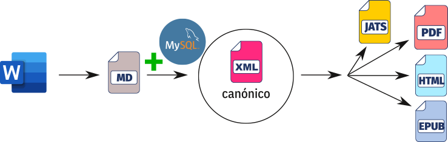

**Español** | [English](README.en.md)

**gbpublisher** es un sistema de producción editorial para libros académicos y revistas científicas. Lleva el trabajo desde el manuscrito hasta las salidas finales —PDF, EPUB, HTML y los XML que piden los indexadores— a partir de una única fuente XML canónica: DocBook 5 para libros y JATS 1.4 para revistas.

Es una aplicación de escritorio para Linux con arquitectura cliente-servidor. El equipo editorial trabaja sobre una base MySQL compartida, aunque cada persona esté en su casa. La usan quienes producen el libro o la revista (edición, corrección, maquetación y coordinación), no está pensada para autores.

Los textos se escriben en Markdown y se normalizan con Pandoc. Las salidas salen del XML canónico por XSLT y se componen con LuaLaTeX. El PDF es la referencia, el EPUB y el HTML reproducen fielmente su estructura. Las herramientas críticas del proceso (Pandoc, Saxon-HE, epubcheck, veraPDF, packtools) se instalan en versiones fijas, así que un título puede regenerarse idéntico años después.

Cada editorial instala su propia copia, es dueña de sus datos y maneja sus propias credenciales: no hay servidor central ni intermediarios. Solo se usan estándares abiertos.

---

## Modelo de producción

gbpublisher implementa un flujo **Single Source Publishing**: el contenido se redacta en Markdown, se transforma a un XML canónico y se enriquece con metadatos desde una base de datos MySQL. El resultado es un **XML canónico validado** (JATS para revistas y DocBook para libros) que actúa como fuente única para todas las salidas editoriales.

Desde ese XML canónico se generan:

- **Revistas:** PDF, EPUB 3 y HTML; los XML para Crossref, DOAJ, SciELO y Redalyc/Marcalyc.
- **Libros:** PDF compuesto con LuaLaTeX (también PDF/A), EPUB 3 y HTML.

PubMed Central figura en el plan de trabajo; todavía no está implementado.

Este enfoque garantiza reproducibilidad, trazabilidad y portabilidad total de los contenidos, sin depender de plataformas propietarias ni servicios externos.

---

## Estado del desarrollo

- **Revistas:** operativo, desde el ingreso del manuscrito hasta las salidas para indexadores, web e impresión.
- **Libros:** en desarrollo activo. Ya produce títulos completos con índices, glosario, siglas, notas y bibliografía en APA, ISO 690, IEEE y Vancouver.

---

## Funcionalidades principales

**Gestión de metadatos**
- Autores, afiliaciones, ORCID, ROR
- Referencias bibliográficas (BibTeX/BibLaTeX)
- Palabras clave, datos institucionales, información para indexadores
- Control del flujo editorial: estado de cada pieza y publicación

**Edición y producción**
- Editor integrado con resaltado de sintaxis para Markdown y XML
- Generación y validación del XML canónico con Saxon-HE
- Transformación a múltiples salidas mediante XSLT 2.0

**Validación y calidad**
- El canónico se valida con su esquema (RNG o DTD) y con reglas Schematron propias y de JATS4R
- Cada salida pasa por su validador: epubcheck, veraPDF, el Nu Html Checker (vnu) y packtools para SciELO
- Verificación de DOI contra Crossref; consulta de ORCID
- Los archivos para DOAJ y Crossref se generan y validan en la aplicación, y se suben a mano a cada servicio

**Auditor de XML externos**
- Revisa un JATS producido fuera de gbpublisher: estructura, DTD y un subconjunto de reglas de JATS4R

---

## Requisitos del sistema

- **Linux Mint con escritorio Cinnamon** (única plataforma soportada)
- **Servidor de pantalla X11**
- Gambas 3.22 con Qt 6 (la instala el paquete `.deb`)
- MySQL 8
- Java
- TeX Live completo
- xmllint

Las herramientas que deciden el resultado de una salida no se toman del sistema: se instalan en versiones fijas en `/opt` desde la propia aplicación (menú **Acerca de → Controlar integridad del sistema**, con un proyecto abierto). Son Pandoc 3.1.3, Saxon-HE 12.9, epubcheck 4.2.6, veraPDF 1.30.1 y packtools 4.18.2. El validador de HTML (vnu) se suma a esa lista próximamente.

---

## Licencia

gbpublisher se distribuye bajo la **Business Source License 1.1 (BSL 1.1)**.

**Uso permitido sin costo:** producción editorial de revistas científicas o académicas que no cobren APC (Article Processing Charges) a los autores, bajo cualquier denominación.

**Uso que requiere licencia comercial:** revistas que cobren APC, servicios editoriales para terceros, plataformas SaaS y redistribución del software.

Cada versión publicada convierte automáticamente su licencia a **GPL-3.0-or-later** transcurridos cinco años desde su fecha de lanzamiento.

Véase [LICENSE.md](LICENSE.md) para los términos completos.

---

## Información del proyecto

- Repositorio: [https://github.com/albertomoyano/gbpublisher](https://github.com/albertomoyano/gbpublisher)
- Instalación: [LEEME.md](LEEME.md)
- Base de datos: [BBDD_LEEME.md](BBDD_LEEME.md)
- Arquitectura: [ARCHITECTURE.md](ARCHITECTURE.md)
- Consultas sobre licenciamiento: [contacto@estudio2a.ar](mailto:contacto@estudio2a.ar)
- Cómo apoyar el proyecto: [SUPPORT_MODEL.md](SUPPORT_MODEL.md)

**Copyright © 2026 Alberto Moyano**
